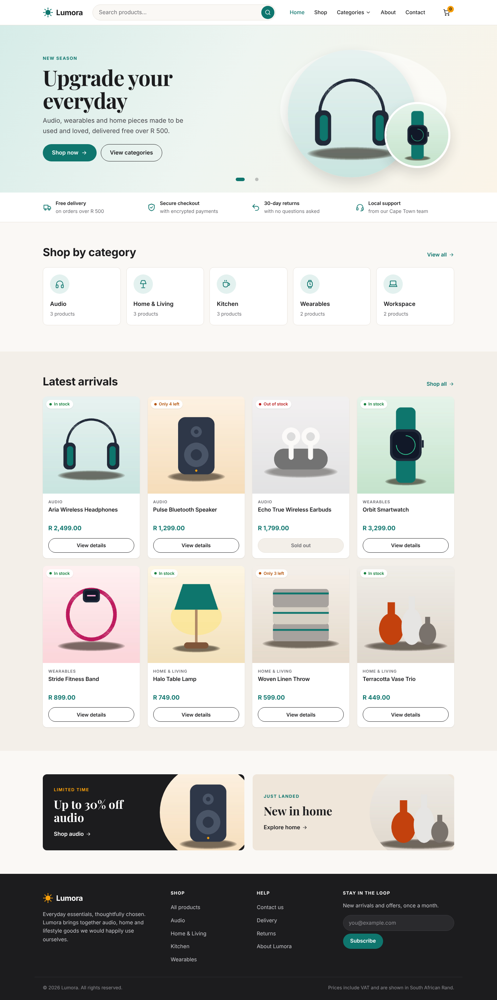
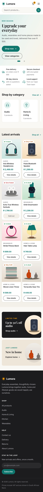
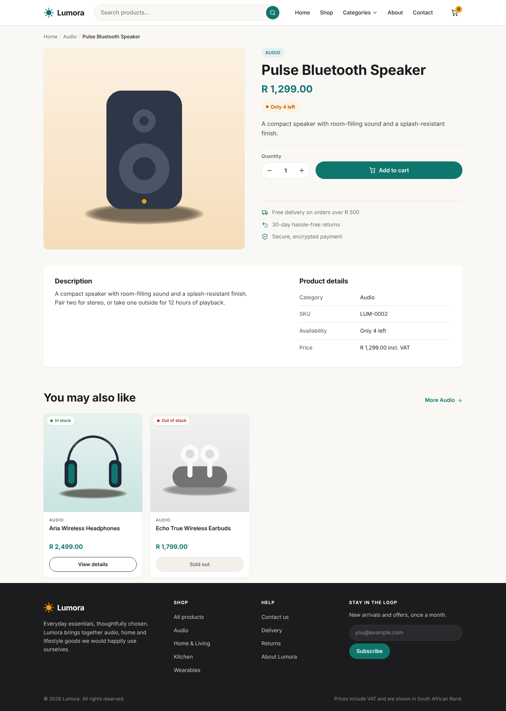
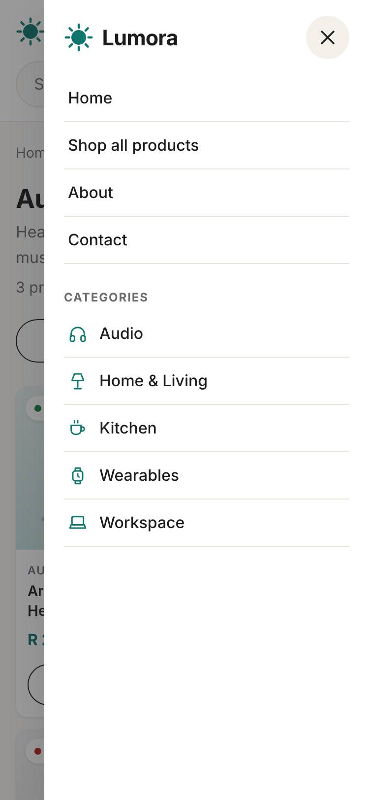

# Lumora store

A small Laravel 11 + MySQL e-commerce site with a responsive storefront. The admin dashboard (login, statistics, product management) is being built separately and will be added to this README when it lands.



## Requirements

- PHP 8.2 or newer with the `pdo_mysql`, `mbstring`, `fileinfo` and `gd` extensions
- Composer 2
- MySQL 8 (or MariaDB 10.6+)

No Node build step is needed: the storefront uses plain CSS and JavaScript in `public/`.

## Install and run

```bash
git clone https://github.com/athenkosi-nomavila/store.git
cd store
composer install
cp .env.example .env
php artisan key:generate
```

Create a database and a user for it, then put the credentials in `.env`:

```sql
CREATE DATABASE lumora CHARACTER SET utf8mb4 COLLATE utf8mb4_unicode_ci;
CREATE USER 'lumora'@'localhost' IDENTIFIED BY 'choose-a-strong-password';
GRANT ALL PRIVILEGES ON lumora.* TO 'lumora'@'localhost';
```

```dotenv
DB_CONNECTION=mysql
DB_HOST=127.0.0.1
DB_PORT=3306
DB_DATABASE=lumora
DB_USERNAME=lumora
DB_PASSWORD=choose-a-strong-password
```

Create the tables, load the sample catalogue and expose uploaded images:

```bash
php artisan migrate --seed
php artisan storage:link
php artisan serve
```

Open http://127.0.0.1:8000.

To run the tests (they use an in-memory SQLite database, so MySQL is not touched):

```bash
php artisan test
```

## What is in the storefront

| URL | What it shows |
| --- | --- |
| `/` | Hero banner, trust strip, category tiles, the 8 latest products, promo panels |
| `/shop` | All active products, with sort, category filter and pagination (12 per page) |
| `/search?q=...` | Products whose name or description matches the term |
| `/category/{slug}` | Products in one category |
| `/products/{slug}` | Product details, stock status, quantity selector, related products |
| `/about`, `/contact` | Static pages |

Only products marked active are shown, and stock status comes from quantity: more than 5 is "In stock", 1 to 5 is "Only N left", 0 is "Out of stock" with buying disabled.

## Project structure

```
app/Http/Controllers/Shop/     Home, catalogue (shop/search/category), product, newsletter
app/Http/Requests/             ProductListingRequest: validates q, sort, category, page
app/Http/Middleware/           SecurityHeaders: CSP and other browser protections
app/Models/                    Category hasMany Product; Product belongsTo Category
database/migrations/           users, categories, products (foreign key category_id)
database/seeders/              5 categories, 14 products (13 active) with images
resources/views/layouts/       app.blade.php: header, mobile drawer, footer
resources/views/shop/          home, product, search (also used for /shop and categories)
resources/views/components/    product-card, availability-badge, product-image, icon, logo
public/css/app.css             All styles; brand tokens on :root
public/js/app.js               Drawer, dropdown, carousel, filters, quantity selector
tests/                         Feature tests for pages, search and security; unit tests for stock rules
```

### Database

- `categories`: `name` and `slug` are unique.
- `products`: `category_id` is a foreign key to `categories.id` with `ON DELETE RESTRICT`, so a category cannot be removed while products use it. `slug` and `sku` are unique; `price` is `DECIMAL(10,2)`; `quantity` is unsigned; `is_active` and `created_at` are indexed together for the listing queries.
- `users`: the stock Laravel table, used by the admin login.

## Security in the storefront

- **SQL injection.** All queries go through Eloquent. The search term is only ever a bound parameter (`whereRaw("name LIKE ? ESCAPE '!'", [$like])`), and `%` and `_` typed by a visitor are escaped so they match literally.
- **XSS.** Every value is printed with Blade's escaped `{{ }}`, including the search term echoed back. There is no `{!! !!}` in the views. A Content Security Policy allows scripts only from this site, and there are no inline scripts or `onclick` handlers.
- **CSRF.** The only form that posts (newsletter) carries `@csrf`; Laravel rejects posts without a valid token with a 419.
- **Input validation.** Listing parameters are validated by `ProductListingRequest`: the search term is a string of at most 100 characters, sort must be one of four known values, and the category must exist.
- **Hidden data.** Inactive products return 404, the same as missing ones.
- **Abuse.** The newsletter endpoint is rate limited to 5 requests a minute.
- **Headers.** `X-Content-Type-Options: nosniff`, `X-Frame-Options: DENY`, `Referrer-Policy` and `Permissions-Policy` are set on every page.
- **Credentials.** Secrets live only in `.env`, which is git-ignored; `.env.example` holds placeholders.

## Screenshots

| Desktop | Mobile |
| --- | --- |
|  |  |
|  |  |
