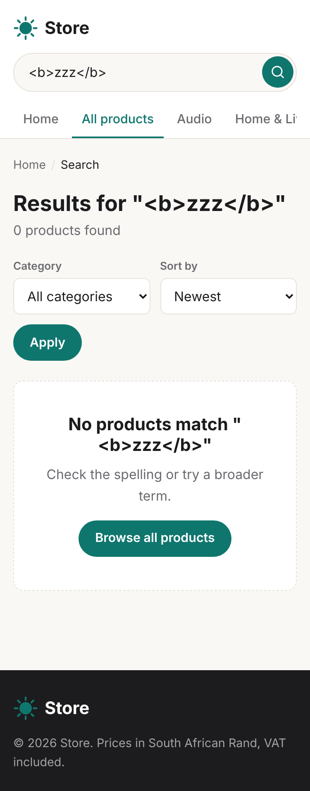

# Store

A small Laravel 11 e-commerce site. This first part is the customer-facing storefront. It reads a sample catalogue from `config/catalog.php`, so it needs no database yet. The MySQL tables and the admin dashboard (login, statistics, product management) come in a later change, and this README will be updated then.


## Requirements

- PHP 8.2 or newer with the `mbstring` extension
- Composer 2

No database and no Node build step are needed. The storefront is plain HTML and CSS, with no JavaScript.

## Install and run

```bash
git clone https://github.com/athenkosi-nomavila/store.git
cd store
composer install
cp .env.example .env
php artisan key:generate
php artisan serve
```

Open http://127.0.0.1:8000.

To run the tests:

```bash
php artisan test
```

## What is in the storefront

| URL | What it shows |
| --- | --- |
| `/` | Promotional banner, category tiles, the 8 latest products |
| `/shop` | All active products, with sort, category filter and pagination (12 per page) |
| `/search?q=...` | Products whose name or description contains the term |
| `/category/{slug}` | Products in one category |
| `/products/{slug}` | Product details, stock status, more products from the same category |

Only products marked active are shown. Stock status comes from quantity: more than 5 is "In stock", 1 to 5 is "Only N left" and 0 is "Out of stock".

To change the products, edit `config/catalog.php` and put images in `public/images/products/`.

## Project structure

```
config/catalog.php             Sample categories and products (13 active, 1 hidden)
app/Catalog/                   Catalog (lookups, search, sort), Product and Category
app/Http/Controllers/Shop/     Home, catalogue (shop/search/category), product
app/Http/Requests/             ProductListingRequest: validates q, sort, category, page
app/Http/Middleware/           SecurityHeaders: CSP and other browser protections
resources/views/layouts/       app.blade.php: header with search and category menu, footer
resources/views/shop/          home, product, search (also used for /shop and categories)
resources/views/components/    product-card, availability-badge, product-image, icon, logo
public/css/app.css             All styles; brand colours on :root
public/images/products/        Product images
tests/                         Feature tests for pages, search and security; unit tests for stock rules
```

When the database is added, only `app/Catalog/Catalog.php` needs to be replaced with Eloquent queries. The views and controllers already work with `Product` and `Category` objects.

## Security in the storefront

- **XSS.** Every value is printed with Blade's escaped `{{ }}`, including the search term shown back on the results page. The views have no `{!! !!}`. A Content Security Policy blocks inline scripts and scripts from other sites.
- **Input validation.** `ProductListingRequest` validates the listing parameters. The search term must be a string of at most 100 characters, sort must be one of four known values, and the category must exist.
- **Hidden data.** Inactive products return a 404, the same as missing ones.
- **Image paths.** Image URLs are built only from file names in the catalogue, with `basename()`, so a bad entry cannot point outside `public/images/products/`.
- **CSRF.** The storefront has no forms that change data, because search is a read-only GET. Laravel's CSRF middleware is on for every web route and will protect the admin forms.
- **Headers.** Every page sends `X-Content-Type-Options: nosniff`, `X-Frame-Options: DENY`, `Referrer-Policy` and `Permissions-Policy`.
- **Credentials.** Secrets live only in `.env`, which git ignores. `.env.example` holds placeholders.

## Screenshots

| Desktop | Mobile |
| --- | --- |
|  |  |
|  |  |
